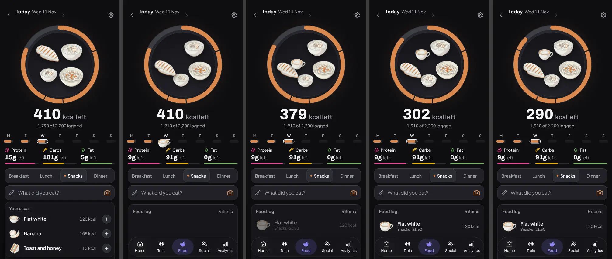
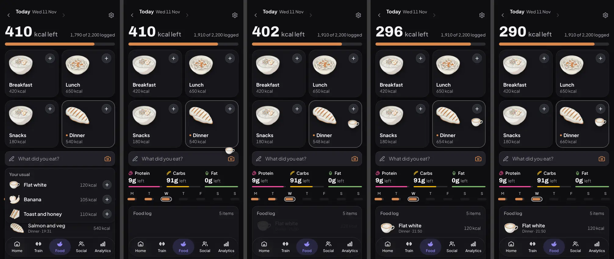
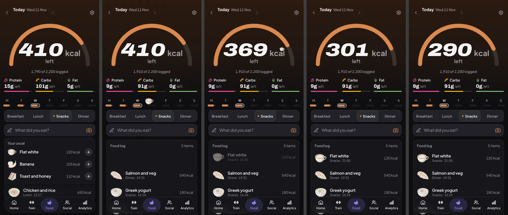
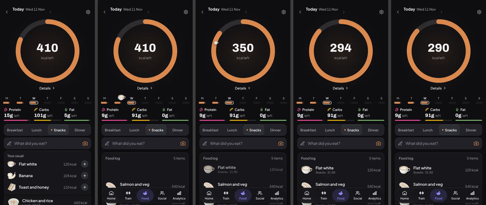

# Food: why it reads flat, and three directions (11 November 2026)

The owner said Food looks flat and disjointed next to Social's Together tab,
that the Breakfast, Lunch, Dinner and Snacks buttons look the wrong size, and
that it may be the orange, the sizing or the plainness. This is the critique
(the `screen-critique` skill), the evidence, and three prototypes to pick from.

**Picked (owner, 11 November 2026):** A's page, with the calorie wheel as it
is today. Section 10 has it.

**Nothing in production changed.** This folder holds words, captures and the
prototype's source.

- **The canvas:** https://claude.ai/artifact/Dxq4g6hy3kyxWk5pjNAdXF. Food today,
  then directions A, B and C at 393 px dark, then the pick in light, at 320 px
  and on an empty day. A, B and C are live: tap "What did you eat?" and add a
  food. Each board has four switches: day, theme, motion and width.
- **Today's page** was measured in the real app on the emulator rig
  (`docs/agents/capture-rig.md`), the seeded e2e account, 393 x 852, with the
  scorer in `scripts/design-qa/screenScore.ts` plus a script that reads control
  sizes, corner radii, text sizes and words from the page.
- **The prototypes** are canvas artboards. They use the app's colours, fonts
  and food art, not its components. Their numbers come from those artboards.

## 1. The diagnosis

Each line has Food's number and the same number from Together or Home.

1. **The hero is small and low.** The ring card is 361 x 192, 25% of the first
   screen, and starts at 170 px. Together's hero is 36% at 92 px. Home's is 58%
   at 92 px. Rule 1 asks for 30 to 60%.
2. **A page title sits above it.** "Food" at 31 px, weight 800. Together and
   Home have no title above the hero (rule 2).
3. **The orange is on buttons, not on the person's data.** Colour is 2.9% of
   the screen, inside the 8% budget. But 60% of it is two filled buttons: the
   Breakfast pill (31.7%) and the camera (28.3%). The ring card holds 14.6%.
   On Together and Home, buttons hold 0% (rules 10 and 12).
4. **The meal buttons are out of scale.** They are 84 x 44 with a 12 px label.
   Every other 44 px control uses a bigger label: Together/Feed 14 px, Join
   challenge 14 px, Start workout 16 px, Home's Log food 14 px. Right under
   them sit a 56 px field and a 56 px camera button. One group, two heights
   (44 and 56) and three corner shapes (pill, 14 and 16).
5. **The text is small.** 42 of 62 words in the first screen (68%) are 12 px
   or smaller. Together 35%, Home 26%. Food uses 7 text sizes, Home 5 (rule 7
   allows 6).
6. **There is almost no picture.** The largest picture is the ring, 9.3% of
   the screen. Together's photo is 30.2%. Home's figure is about 37%. Food has
   ten drawings of its own and shows them at 48 px.
7. **Too many boxes.** 12 boxed things above the tab bar. Together 5, Home 6.
8. **One day is drawn two ways.** With 410 kcal left the hero ring is 19% full,
   because it empties in "left" mode. Today's ring in the week strip, 100 px
   above it, is 81% full. On a day with nothing logged the hero ring is fully
   orange and the screen's colour goes up to 4.70%, where rule 33 draws zero
   as zero.
9. **Different corners.** Food's cards are 16. Together's hero and cards are
   22, and so is Home's hero.
10. **Nothing travels when you log.** The ring redraws over 1.5 s, the number
    counts and a row appears. That is all.

**The cause.** A person opens Food to see how much is left today and to log
the next thing. The page is not laid out by that question. It is laid out by
component, in the order `src/pages/Food.tsx` renders them: date bar, week
strip, ring card, three macro tiles, composer card, timeline. Each one brought
its own box, its own size and its own corner.

## 2. The measurements

393 x 852, dark, the seeded account with four meals logged, unless said.

| Measure                              | Food                    | Together             | Home              |
| ------------------------------------ | ----------------------- | -------------------- | ----------------- |
| Hero share of the first screen       | 25% (361 x 192)         | 36% (361 x 280)      | 58% (361 x 456)   |
| Hero top                             | 170 px                  | 92 px                | 92 px             |
| Page title above the hero            | "Food", 31 px           | none                 | none              |
| Largest text                         | 44 px, the ring figure  | 36 px                | 36 px             |
| Text sizes in the first screen       | 7                       | 9 (medal art counts) | 5                 |
| Words in the first screen            | 62                      | 88                   | 69                |
| Words at 12 px or smaller            | 42 (68%)                | 31 (35%)             | 18 (26%)          |
| Colour share                         | 2.91%                   | 2.07%                | 1.31%             |
| Colour held by filled buttons        | 60%                     | 0%                   | 0%                |
| Largest picture, share of the screen | the ring, 9.3%          | the photo, 30.2%     | the figure, ~37%  |
| Boxed things above the tab bar       | 12                      | 5                    | 6                 |
| Card radius                          | 16                      | 22                   | hero 22, cards 16 |
| Page height                          | 1,395 px (1.64 screens) | 2,069 px             | 1,480 px          |

Other states of Food: nothing logged, colour 4.70% and page 1,154 px; a heavy
day (12 rows, over target), colour 3.69% and page 1,947 px.

Captures: `today-food-typical-393-dark`, `today-food-typical-393-light`,
`today-food-empty-393-dark`, `today-food-heavy-393-dark`,
`today-together-393-dark`, `today-home-393-dark`.

## 3. What other apps do

Searched on Mobbin: MacroFactor, Cal AI, MyFitnessPal, Cronometer, Lose It!,
Yazio and Lifesum, plus Apple Fitness and Oura as the two apps outside food.
**Cronometer and Lose It! are not on Mobbin**, so the counts are out of 5.
All screens are iOS.

Mobbin's notice, as it came back: "**Your Mobbin AI usage is high this month**
Usage is unlimited during beta. If your usage stays at this level, you may
need to purchase more credits once limits take effect.
[View usage and plan options](https://mobbin.com/settings/billing-and-usage?utm_source=claude&utm_medium=ai-assistant&utm_source_platform=mcp)"

| What the day screen does                                  | Count  | Which                           |
| --------------------------------------------------------- | ------ | ------------------------------- |
| A row of meal buttons or chips                            | 0 of 5 |                                 |
| A camera button on the day screen                         | 0 of 5 |                                 |
| Named meals, each its own row with its own add            | 3 of 5 | MyFitnessPal, Yazio, Lifesum    |
| Time order, no meal names                                 | 2 of 5 | MacroFactor, Cal AI             |
| A picture on every row                                    | 4 of 5 | all but Cal AI (scans only)     |
| Macros as bars                                            | 4 of 5 | all but Cal AI (small rings)    |
| The biggest colour is the person's data                   | 3 of 5 | MacroFactor, Cal AI, Yazio      |
| Add buttons in black or white                             | 3 of 5 |                                 |
| The calorie figure is the largest text                    | 2 of 5 | Cal AI, Lifesum                 |
| The hero sits on the page, not in a card                  | 2 of 5 | MacroFactor, Lifesum            |
| Left and eaten both shown at once                         | 3 of 5 | MyFitnessPal, Yazio, Lifesum    |
| A week strip above the hero                               | 3 of 5 | MacroFactor, Cal AI, MFP        |
| A full-screen moment after a log (7 screens, from 5 apps) | 0 of 7 | each is a toast, a pill, a list |

Outside food: Apple Fitness puts the ring straight on the black page, about
30% of the screen, one hue. Oura puts "93" under a thin arc on the page with
no card.

Links:

- MacroFactor: [food log](https://mobbin.com/screens/661ead75-a58c-4d99-957d-61d346e5e54c),
  [dark](https://mobbin.com/screens/8d0c31f9-40fe-45e2-9492-cdc56396da3c),
  [dashboard](https://mobbin.com/screens/f52ef179-c91a-4c7d-952b-9741275c966b)
- Cal AI: [home](https://mobbin.com/screens/cb3f4e20-2375-4264-ad81-f750ceca8829),
  [dark](https://mobbin.com/screens/0b587652-d78b-4abb-8d03-aa9685167524),
  [logging flow](https://mobbin.com/flows/787289b6-39d6-4066-a8f9-d1f5e463bebe)
- MyFitnessPal: [today](https://mobbin.com/screens/9eac9d4d-dffb-4866-b148-3065cefbda51),
  [today 2](https://mobbin.com/screens/32b82d20-deb0-493f-a643-c170d9e46b8b),
  [dark](https://mobbin.com/screens/5b3fe116-74a4-4425-99d0-908b3a9b9de3),
  [after a log](https://mobbin.com/screens/6c335f93-b5fd-4714-b02b-ba31123dbfe7)
- Yazio: [diary](https://mobbin.com/screens/0cc2792f-7c05-4667-9c0f-ba47d6e0c3fe),
  [diary 2](https://mobbin.com/screens/3f98c39d-fd18-4cc8-b3b4-6b85582dffc5),
  [snacks](https://mobbin.com/screens/6a957410-be5e-40cd-8250-5b2bee39297b),
  [just added](https://mobbin.com/screens/b92089c3-a31f-4817-92ee-27c2a318fd51)
- Lifesum: [diary](https://mobbin.com/screens/ba02a832-1a7e-4717-8dae-e96cb104ad78),
  [diary 2](https://mobbin.com/screens/08ea598e-7236-4baa-854c-6bda65bad2a7),
  [after a log](https://mobbin.com/screens/2b80b418-f8b7-467c-a3c5-9a4659c30fb2)
- BitePal (a stand-in, not in the counts of 5): [day](https://mobbin.com/screens/51e4e1aa-21b7-48c2-bef1-ac3e3c642845),
  [after a log](https://mobbin.com/screens/7230eb71-6655-436a-a252-b6d2c605c0c1)
- Apple Fitness: [day](https://mobbin.com/screens/527bed87-fe98-4e4d-b778-b635c9475df5),
  [summary](https://mobbin.com/screens/5b8d5290-6c52-436f-bac3-9d0a531db829)
- Oura: [today](https://mobbin.com/screens/03958157-6ab8-4046-9a49-ebf639baa348),
  [today 2](https://mobbin.com/screens/5a37255c-77fd-4e23-884b-5d9af68a0a38)

## 4. The three directions

All three make the same repairs, because the diagnosis asks for them:

- No "Food" title. The date is the header row, 44 px tall.
- The meal picker is one neutral track, 48 px tall like the field, with 14 px
  labels and 44 px segments. An orange dot marks the meal. When four labels do
  not fit (320 px, or large text) it becomes two rows of two.
- The field is 48 px with the scan button inside it. The camera keeps its
  orange as an icon, not as a filled button.
- The three macro tiles become one row with no boxes: icon, figure, thin bar.
- The week strip is seven bars, edge to edge, so a day is 45 px wide at 320.
- The hero shows what is logged. Nothing logged is a grey track.
- Five text sizes: 48, 20, 16, 14 and 12.

How logging works does not change: type, scan or enter by hand, then save.
In the prototypes "Your usual" stands in for typing and the result sheet.

### A. The plate

The ring becomes the rim of a plate, drawn on the page. The plate holds what
you ate, in Tropos's own food art, sized by kcal, clockwise in the order
eaten. The rim has a tick where each entry ends. The number sits under it.

- **What moves on a log:** the food flies from the field to the plate
  (560 ms). The food already there makes room (500 ms). Then the rim grows
  and the number counts (600 ms, starting at 320 ms). The new row fades in
  (250 ms). About 0.9 s in all. On open the rim draws once (800 ms).
- **Reduced motion:** no flight, no count, no draw. One 150 ms fade.
- Captures: `a-plate-*`, with the log in `a-plate-log-sequence` and
  `a-plate-log-reduced-motion`.

### B. The table

The number and a bar on top. Four meal tiles are the hero and the meal picker
in one. Tap a tile, then add. Each tile holds that meal's food and its kcal.

- **What moves on a log:** the food rises from the field onto its tile
  (420 ms). Then the tile's kcal counts up, the top number counts down and
  the bar grows (500 ms, starting at 300 ms). About 0.8 s.
- **Reduced motion:** one 150 ms fade. No travel, no count.
- Captures: `b-table-*`, with the log in `b-table-log-sequence`.

### C. The arch

A warm band across the top, a half ring, and the number in the display face
at 72 px. No picture.

- **What moves on a log:** the food rises from the field to the end of the
  arc and fades into it (560 ms). Then the arc grows and the number counts
  (600 ms, starting at 300 ms). About 0.9 s. On open the arc draws once
  (800 ms).
- **Reduced motion:** no flight, no count, no draw.
- Captures: `c-arch-*`, with the log in `c-arch-log-sequence`.

### The same measures, for each

| Measure (393 x 852, dark, four meals) | Food today | A. Plate  | B. Table  | C. Arch                    |
| ------------------------------------- | ---------- | --------- | --------- | -------------------------- |
| Hero share                            | 25%        | 36.9%     | 43.8%     | 47.4% (arch and number 24) |
| Hero top                              | 170 px     | 80 px     | 80 px     | 0 px                       |
| Largest text                          | 44 px      | 48 px     | 48 px     | 72 px                      |
| Text sizes                            | 7          | 5         | 5         | 6                          |
| Words in the first screen (limit 60)  | 62         | 59        | 67        | 67                         |
| Words at 12 px or smaller             | 42 (68%)   | 18 (31%)  | 18 (27%)  | 21 (31%)                   |
| Colour, dark (limit 8%)               | 2.91%      | 3.62%     | 1.88%     | 2.73%                      |
| Colour, light (limit 15%)             | 2.78%      | 3.52%     | 1.83%     | 2.66%                      |
| Colour held by filled buttons         | 60%        | 0%        | 0%        | 0%                         |
| Share of the colour that is orange    | 91%        | 93%       | 87%       | 92%                        |
| Colour, nothing logged                | 4.70%      | 0.24%     | 0.24%     | 0.24%                      |
| Colour, heavy day                     | 3.69%      | 4.25%     | 2.20%     | 3.33%                      |
| Boxed things above the tab bar        | 12         | 3         | 6         | 3                          |
| Lowest text contrast, dark            | not read   | 4.86 to 1 | 4.86 to 1 | 4.86 to 1                  |
| Lowest text contrast, light           | not read   | 4.54 to 1 | 4.54 to 1 | 4.94 to 1                  |
| Controls under 44 x 44                | not read   | none      | none      | none                       |

## 5. What was checked on each prototype

A script loaded each artboard in 11 cases: typical, empty and heavy days;
dark and light; 393 and 320 px; and three cases with every font size scaled
by 1.35 (the tab bar was left at its size, since the app's own large-text
spec covers it).

- **Contrast (section 10).** Every visible text node against the colour
  behind it, taking the worst stop of a gradient. No text is under 4.5 to 1
  in any case. The lowest is the tab bar's "Food" label (4.86) in dark and
  the date (4.54) in light.
- **Colour budget.** Every case is inside 8% dark and 15% light. The highest
  is A on a heavy day at 320 px, 5.03%. No filled button carries colour.
- **320 px and large text.** Nothing runs past the screen, nothing is cut
  short and no words sit on other words, with one known miss: in C the
  72 px number leaves the arch when text is scaled
  (`c-arch-typical-320-large-text`). It would need a size cap.
- **Reduced motion.** Each board has a motion switch, and each also follows
  the system setting. Flights, counts and draw-ins are removed. What is left
  is a 150 ms fade.
- **What animates.** Transform and opacity only, with one exception said
  plainly: the rim in A and the arc in C grow by redrawing a stroke
  (`stroke-dashoffset`), which is a repaint. Today's ring does the same.
  B has no such part. No blur is animated. The tab bar's blur and the art's
  shadows do not change.

The first run found five misses, fixed in the prototypes and worth keeping
in the build: meal segments 38 px tall (now 44); day buttons 41 px wide at
320 (now 45); the empty plate's words at 4.23 to 1 in light (now 5.8);
C's grey text on its light band at 4.32 (now 5.3); and labels cut short at
large text (the picker now wraps, and "left" drops under a macro figure).

The script reads text only, so icons were worked out by hand. The orange
camera icon and the picker's dot were 2.6 to 1 on the light field. In light
they now use the deeper orange: 5.6 to 1 and 5.9 to 1 (5.8 and 5.0 in dark).
One miss stays: in light the orange rim on A's white plate is 2.8 to 1, under
the 3 to 1 asked of a drawing. Today's ring uses the same orange on white,
and the number says the value in text.

## 6. The pick, and where it is weakest

**A, the plate.** It is the only one that uses all three of the owner's ideas
in one object: food goes in, the ring does more, and the ring is the page.
Its hero is a picture made from the person's own day, which is what
Together's hero does with their race. It also has the fewest boxes (3) and
the fewest words (59).

Where A is weakest:

1. **Ten drawings.** Two of the four meals in the demo are the same bowl. It
   needs about 20 more or the plate repeats itself.
2. **A drawing is a guess.** Chicken and rice shows as a bowl of rice.
3. **Past 7 items it shows "+5".** A heavy logger sees much the same full
   plate each day.
4. **The most motion of the three.** 0.9 s on something done 3 to 6 times a
   day. It never blocks typing, and a second log can start before it ends.
5. **The rim redraws a stroke.** That is paint, not a move or a fade.
6. **Light theme.** White art on a pale plate has less punch than on dark,
   and the orange rim is 2.8 to 1 against the plate (see section 5).
7. **At 320 px** the meal picker is two rows, so the diary starts 46 px lower.

B is the safe choice: the least colour and the least motion, and it is how
3 of 5 food apps lay out a day. But it puts the meal slots back in front,
which Food8 moved away from, and it has twice A's boxes. C looks the boldest
in a screenshot and has no picture, breaks the type rules, and fails large
text.

## 7. What each direction breaks

| Earlier decision or rule                                                  | A                                     | B                    | C                   |
| ------------------------------------------------------------------------- | ------------------------------------- | -------------------- | ------------------- |
| The quiet ring, DS3 29 Sep: one plain arc, grey groove, no extras         | adds ticks, an over lap, a soft light | the ring leaves Food | half ring, band     |
| One ring in two sizes, Food and Home (DS3)                                | Home's ring differs                   | Home keeps it alone  | Home's ring differs |
| The wheel and macro bars empty in "left" mode (today; Food10 built on it) | fill with logged                      | fill with logged     | fill with logged    |
| The week strip as rings (DS3)                                             | bars                                  | bars                 | bars                |
| One timeline leads the page (Food8)                                       | kept                                  | meal slots lead      | kept                |
| Figure 40 to 48 px on an everyday screen (rule 5)                         | kept, 48                              | kept, 48             | 72                  |
| Display type only on finish, best, streak, live (rule 6)                  | kept                                  | kept                 | broken              |
| A band is for a session or a place (rule 23)                              | kept                                  | kept                 | broken              |
| Words in the first screen, 60 at most                                     | 59                                    | 67                   | 67                  |
| The orange meal picker (a comment in `FoodComposerCard.tsx`, not a lock)  | neutral, orange dot                   | tiles, orange dot    | neutral, orange dot |

That comment says a neutral picker was tried before and put back, because
Food was left with no colour of its own. Here the orange stays on Food. It
moves from the button to the data: the rim, the bar or the arc.

Kept in all three: kcal, the house voice, the AI consent wording (not shown
or changed), meal photos staying on the device (no photo is drawn anywhere
new), macro colours on icon and bar only (Food7), a 48 px picture on every
row (Pol1).

## 8. The build plan for A

Each step is one pull request with before and after captures and the
`npm run score:screens` table. Steps 1 to 5 are worth doing whichever
direction is picked.

0. **Lock the pick** in the plan file on its own `claude/lock-<id>` branch,
   naming what it reverses: the quiet ring's single arc, the emptying
   ring, the week strip as rings.
1. **Header.** Drop the "Food" title. The date bar is the header row.
2. **Composer.** One neutral 48 px meal picker with 14 px labels that wraps
   to two rows when four do not fit. A 48 px field with the scan button
   inside. Mirror it in `EditServingsSheet`.
3. **Macros.** Three tiles become one row with no boxes.
4. **One truth for the ring.** It fills with what is logged in both modes,
   and nothing logged is a grey track. `CalorieRing` is shared with Home's
   `TodayEnergy`, so both change together.
5. **Week strip.** Seven bars, edge to edge.
6. **Food art.** About 20 more drawings, cut out for the plate, with their
   keywords in `src/lib/foodArt.ts`. Art only.
7. **The plate, still.** A new hero in place of `FoodHeroCard`: rim, ticks,
   the over lap, the packed food, the number under it. The packing is a pure
   function with tests (same input gives the same plate, nothing leaves the
   well, nothing overlaps, 7 pieces then "+N"). Empty day, light, 320 px.
8. **The plate, moving.** The flight, the food making room, the delayed rim
   and count, and the reduced-motion path. Transform and opacity through
   `Element.animate`, no animation-frame loop.
9. **Home.** Owner's call: Home keeps its small ring, or takes a small plate.
10. **Checks.** `largeText.capture.spec.ts` for Food at 393 and 320, and a
    row in `docs/qa/pre-launch-backlog.md` for what only a phone shows: the
    flight at 120 Hz, the keyboard, Dynamic Type.

One open call inside step 7: a scanned meal could sit on the plate as the
person's own photo, read from the device and cut to a circle, in place of a
drawing. It never leaves the device (Food9) and it is their own picture
(rule 26). Free accounts have no photos and would see drawings.

## 9. What could not be verified

- Cronometer and Lose It! are not on Mobbin, so nothing here is counted for
  them.
- The hero shares for other apps are estimates read off stills, not measured
  with code. Whether Yazio's and Lifesum's meal pictures are the person's
  own is not known. MacroFactor's main screen could be its food log or its
  dashboard; the food log was counted.
- No phone. Frame rate, haptics, the keyboard, safe areas and real Dynamic
  Type were not seen. Large text was faked by scaling every font size 1.35
  times in a browser.
- The prototypes are artboards, not the app's components. A build could
  measure a little differently.
- The hero box of each prototype was marked by hand. The app's scorer picks
  the largest block, which is approximate.
- Today's page was not read for contrast or for controls under 44 px.
- The two word counts (today's page, the prototypes) use the same rule,
  visible words in the first 852 px with the tab bar, from two scripts.

## 10. The owner's pick (11 November 2026)

The owner, on seeing the canvas: "I like a bit with our calorie wheel the same
as currently without the food inside and with the calories inside instead like
we have now". Read as: A's page, but the hero is the calorie wheel as it is
today, with the calories inside it and no food on it.

It is on the canvas as the second row, live, with its light, 320 px and
empty-day boards.

**What it is.** Everything section 4 lists as shared: no title, the date as
the header row, the neutral 48 px meal picker, the 48 px field with scan
inside, the macros as one row, the week as bars. The hero is today's wheel:
one plain orange arc on a grey groove, the number in the text colour, the
grey label, a deeper orange lap when over, a tap to switch left and logged,
and Details under it. It sits on the page at 264 px. Today it is 176 px in a
card.

**What moves on a log.** The food rises from the field to the end of the arc
and fades into it (560 ms). Then the arc grows and the number counts (600 ms,
starting at 300 ms). About 0.9 s; today the wheel alone takes 1.5 s. With
reduced motion there is no flight, no count and no draw.

| Measure (393 x 852, dark, four meals) | Food today | The pick   |
| ------------------------------------- | ---------- | ---------- |
| Hero share                            | 25%        | 33.2%      |
| Hero top                              | 170 px     | 80 px      |
| Largest text                          | 44 px      | 48 px      |
| Text sizes                            | 7          | 5          |
| Words in the first screen (limit 60)  | 62         | 64         |
| Words at 12 px or smaller             | 42 (68%)   | 21 (33%)   |
| Colour, dark (limit 8%)               | 2.91%      | 4.59%      |
| Colour, light (limit 15%)             | 2.78%      | 4.50%      |
| Colour held by filled buttons         | 60%        | 0%         |
| Colour, nothing logged                | 4.70%      | 0.24%      |
| Colour, heavy day                     | 3.69%      | 5.49%      |
| Boxed things above the tab bar        | 12         | 3          |
| Lowest text contrast, dark and light  | not read   | 4.86, 4.54 |
| Controls under 44 x 44                | not read   | none       |

Checked in 13 cases (the 11 of section 5, and two with the wheel emptying as
it does today): no text under 4.5 to 1, no control under 44 px, nothing cut
off, colour at most 6.62% (a heavy day at 320 px). It shows 64 words, 4 over
the limit, because two diary rows fit where today shows one.

### Two calls the owner handed over

The pick left two questions open. Asked which way each should go, the owner
replied "You figure it out best". Decided as below. Each is still a switch on
the board, so the other way can be seen.

**The wheel fills with what is logged, in both modes.** The number still
follows the left and logged switch ("410 kcal left"). The arc always shows how
much of the target is logged, and nothing logged is a grey track.

- Today the wheel empties in "left" mode. With 410 left it is 19% full while
  the same day's mark in the week strip, 100 px above it, is 81% full
  (finding 8).
- Today a day with nothing logged is a fully orange wheel: 4.70% colour, the
  page's loudest state on the day nothing was done, and every new account's
  first day. Rule 33 draws a metric at zero as zero. Filled this way it is
  0.24%.
- Logging now adds colour where it took it away, and reaching the target is a
  full wheel where it was an empty one.
- The macro bars, the Details sheet's bars and Home's wheel run the same way.
  So Food10's rule stands (the card and the sheet never run in opposite
  directions) and the direction it described for "left" mode is reversed.
- Rejected: keeping it as today, for the reasons above. Turning the week
  strip round to match, because a past day can only be read as what was
  logged.

`d-wheel-as-now-typical-393-dark` and `d-wheel-as-now-empty-393-dark` show
today's behaviour on the same page.

**The food flies to the wheel on a log.** It ties the thing just logged to
the wheel changing, which finding 10 said was missing.

- Limits: one flight a log, however many items it holds. None when the wheel
  is off the screen, on an edit, on a delete, or on a day that is not today.
  Nothing under reduced motion. Transform and opacity only. It never blocks
  typing.
- It is the last pull request and its own, so it can be dropped without
  touching the rest.
- Rejected: leaving it out, because it is the one part of the owner's first
  idea ("animate food going in") this pick still carries. A full-screen
  moment, because 0 of 7 logging screens on Mobbin use one.

**What it changes in earlier decisions.** The quiet ring's look stands, and
Home keeps the same wheel. It reverses the wheel and bars emptying in "left"
mode. It replaces the orange meal picker with the neutral one, turns the week
strip's rings into bars, and takes the wheel out of its card.

**The build plan.** From section 8, steps 1 (header), 2 (composer),
3 (macros), 4 (one truth for the wheel, with the macro bars, the Details
sheet and Home in the same change) and 5 (week strip) stand as written.
Steps 6 to 9 (more drawings, the plate, Home's own question) fall away. In
their place:

- **The wheel on the page.** Take `CalorieRing` out of `FoodHeroCard`'s card,
  draw it at 264 px with Details under it, and move the targets gear to the
  header row. One pull request.
- **The flight.** The food rising to the arc and fading, with its limits and
  the reduced-motion path. Transform and opacity through `Element.animate`.
  One pull request, last.
- **Checks**, as step 10.

Captures: `d-wheel-*`.

## The prototype's source

`prototype/build.py` writes the three artboards from one shared shell. It is
throwaway: it exists so the directions can be rebuilt, not to be built on.
