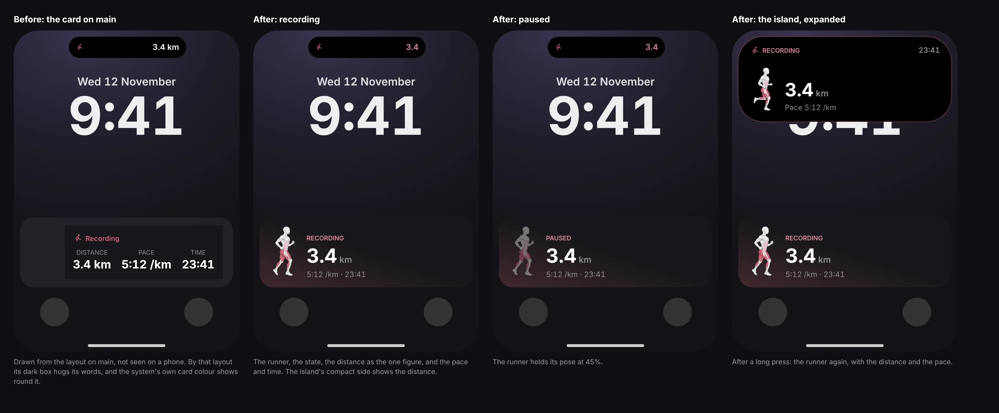

# The run's Live Activity, before and after (Wid2, 12 November 2026)

Four phones at 393 pt wide: the card on main, the new card while
recording, the new card paused, and the island expanded.

**These are drawings of the layouts, not captures from a phone.** No tool
in this repository draws a Live Activity: the web has none, and CI's
simulator build compiles the widget without running it. Each picture is
the card's layout (`src/lib/runLiveActivity.ts`) set out by hand in HTML
with the same sizes, colours and images, in a stand-in for the system's
font. The device rows in `docs/qa/pre-launch-backlog.md` and
`docs/run-live-activity.md` are what will show the real thing.

The owner chose this look from three on a phone mockup; the plan file's
Wid2 row has the decision, and DESIGN_GUIDE §14q how to draw to it.
